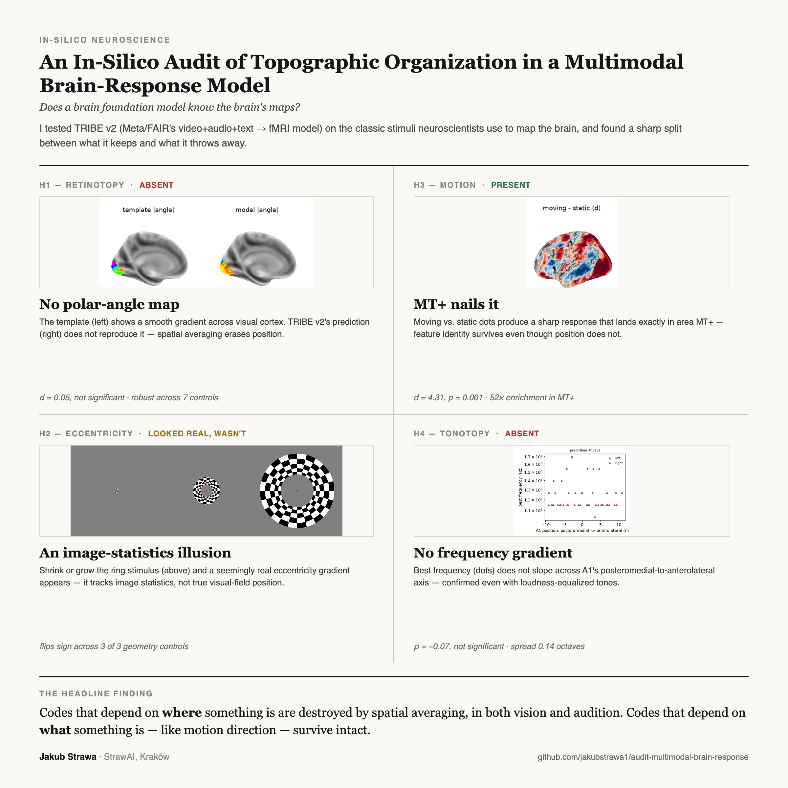
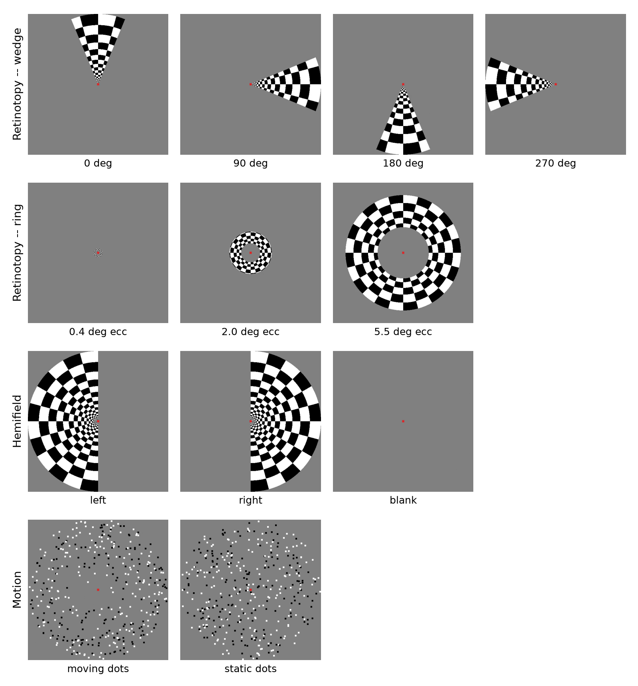
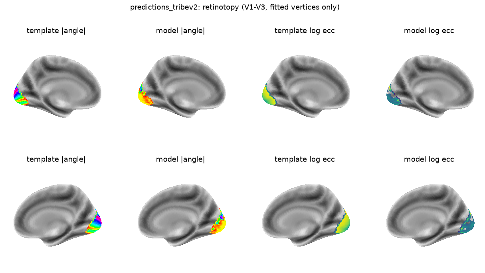
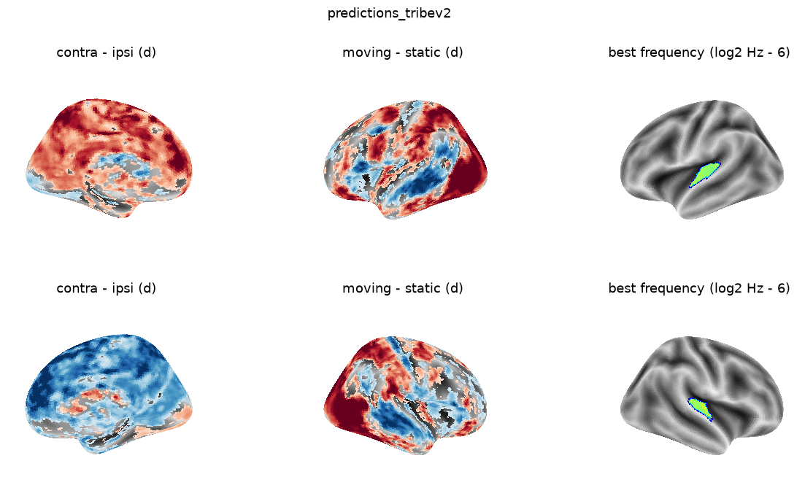

# An In-Silico Audit of Topographic Organization in a Multimodal Brain-Response Model

*Does a brain foundation model know the brain's maps?*

**Live page: https://jakubstrawa1.github.io/audit-multimodal-brain-response/**

An in-silico audit of TRIBE v2 (Meta/FAIR) — the classic retinotopy, tonotopy and motion
stimuli neuroscientists use to map the brain, run through the model and checked against
published human atlases.

- Retinotopy and tonotopy: no positional map survives.
- Motion: direction selectivity is present and lands precisely in area MT+.
- Eccentricity: a seemingly real gradient turns out to be an image-statistics artifact,
  not a true positional code.

Full writeup, hypotheses and controls are in [`assets/paper.pdf`](assets/paper.pdf) (also
linked from the live page).



## Stimuli

The classic retinotopy, hemifield and motion stimuli, as actually fed to the model:



## Key results

Fitted polar-angle and eccentricity maps vs. the published Benson template — no structure
survives in either:



Hemifield, motion and best-frequency contrast maps — the motion cluster lands precisely in
MT+, the other two show no spatial organization:



## Repo contents

```
index.html          landing page (static HTML, no build step)
assets/
  paper.pdf          full writeup
  figures/           result figures used on the page
  videos/            short re-encoded loops of the stimulus videos
poster/
  poster.png          square summary poster (LinkedIn/Facebook-ready)
  poster.html          source for the poster, with its own crops/ images
```

## Preview locally

```bash
python3 -m http.server 8000
```

then open http://localhost:8000.
